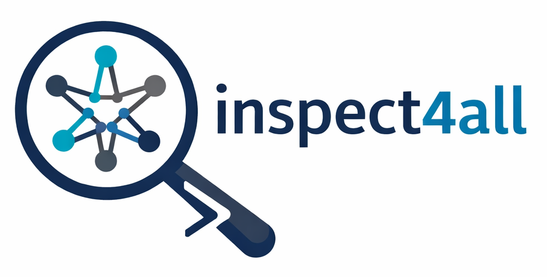
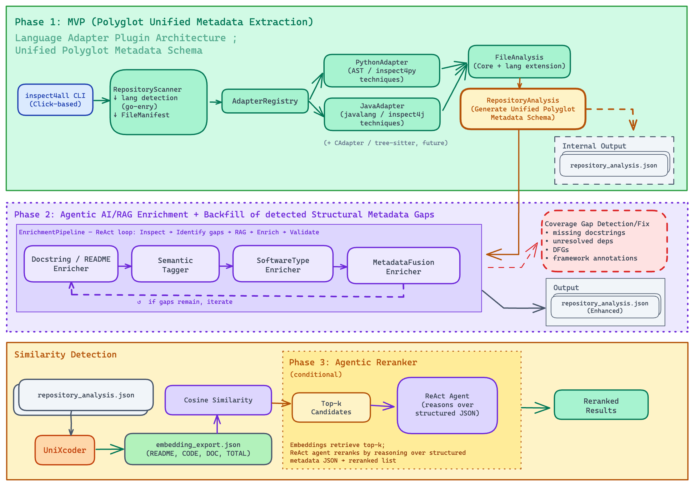

# inspect4all
[](https://git.ecdf.ed.ac.uk/semanticrepohub/inspect4all/-/pipelines/latest)
[](https://www.python.org/)

[](https://opensource.org/licenses/BSD-3-Clause)



Inspect4all is a single language-agnostic tool for inspecting and understanding software repositories.

Based upon [inspect4py](https://github.com/SemanticRepoHub/inspect4py), it extends capabilities to extract relevant information and metadata (functions/APIs, documentation such as README, dependencies, inspects/outputs, licenses, etc) from software repositories in various programming languages, and serve as the foundation to generate multi-level cross-language embeddings for repository analysis and software understanding.

## Features

Given a folder (i.e. a git repository) with code, `inspect4all` will:

- Extract all imported modules, components, libraries, and APIs
- Extract all functions in the code, including their definitions, (parameters, return type, etc,), and documentation
- Extract all classes and structures in the code
- Extract the hierachy of directories and files
- Extract library and software dependencies used in the software project or component
- Identify and classify tests from files
- Identify and classify the main type of the software project (script, package, library or service)
- Software invocation

The main format for all metadata extracted is in JSON for supporting machine readability and automation.

inspect4all works only for **Python and Java projects** or a mix of these two languages (i.e. ployglot repository) for now. Other languages will be supported subsequently.

## Work Phases

The work on `inspect4all` is organized into three distinct phases:



1.  **Phase 1: Static Extraction (MVP)** — The core engine traverses the repository, identifies source files (using `go-enry`), and invokes language-specific adapters (Python/Java) to extract structural metadata into a unified JSON schema. **Baseline similarity** is also performed in this phase as part of the MVP using multi-level embeddings.
2.  **Phase 2: Agentic AI Enrichment (Stretch)** — An AI-powered enrichment pipeline (built on an agentic harness and ReAct patterns) backfills missing metadata, such as generating docstrings for undocumented functions or resolving complex dependencies.
3.  **Phase 3: Agentic AI Reranking (Stretch)** — A high-precision reranking agent reasons over the structured metadata to rescore top-k results, providing explainable and higher-precision rankings.


### Capability not in the MVP

- Extract the call list
- Extract the control flow or call graph of each file (useful for enrichment)
- Extract the data flow graph for every function (not useful for similarity ranking)

## Quick Start

### Prerequisites

- Python 3.12+
- [uv](https://docs.astral.sh/uv/) package manager
- Docker (optional, for containerized development)

### Development Setup

```bash
# Clone and setup development environment
make dev-setup
```

This installs all dependencies and configures pre-commit hooks. Pre-commit hooks enforce ruff linting on every commit.

### Build the Tool

To build the python wheel and package for `inspect4all`, run the make command below. Additionally, a docker image can also be built.

```bash
# Build python wheel and sdist
make build

# Build production Docker image
make docker-build
```

### Run the Tool

After building the tool using `make build`, it can be run with

```bash
inspect4all --help
inspect4all -i /path/to/repo
```

The multi-arch docker image setup allows running the tools without contaminating local environment. To use it, run with

```bash
docker run --rm git.ecdf.ed.ac.uk:5050/semanticrepohub/inspect4all inspect4all --help
```

Alternatively, during development, it can also be run with uv directly without building the wheels

```bash
uv run inspect4all --help
uv run inspect4all -i /path/to/repo
```

## Commands

### Development

| Command              | Description                                                     |
| -------------------- | --------------------------------------------------------------- |
| `make dev-setup`     | Setup development environment (install deps + pre-commit hooks) |
| `uv run inspect4all` | Run inspect4all (pass flags directly, e.g. `-i /path/to/repo`) |
| `make test`          | Run tests                                                       |
| `make test-cov`      | Run tests with coverage report                                  |

### Code Quality

| Command             | Description                                                |
| ------------------- | ---------------------------------------------------------- |
| `make lint`         | Check linting (ruff)                                       |
| `make lint-fix`     | Auto-fix lint issues                                       |
| `make format`       | Format code (ruff)                                         |
| `make format-check` | Check code formatting                                      |
| `make type-check`   | Run type checking (mypy)                                   |
| `make all-checks`   | Run all quality checks (lint + format + type-check + test) |

### Docker

| Command                          | Description                              |
| -------------------------------- | ---------------------------------------- |
| `make docker-build`              | Build production Docker image            |
| `make docker-build-all`| Build production image for amd64 + arm64 |
| `make docker-test`               | Run tests in container                   |
| `make docker-lint`               | Run linting in container                 |
| `make docker-down`               | Stop Docker containers                   |

<details>
<summary>Alternative: Using docker and docker compose directly</summary>

```bash
# Run tests
docker compose run --rm test

# Run linting
docker compose run --rm lint

# Build production image
docker build --target production -t inspect4all .

# Run the CLI tool via the production image
docker run --rm inspect4all --help
docker run --rm -v /path/to/repo:/data inspect4all -i /data
```

</details>

### DevContainer (VS Code / GitHub Codespaces) Support

Open the project in VS Code, and select "Reopen in Container" when prompted, or use the Command Palette: `Dev Containers: Reopen in Container`.

## Releasing

This project uses [semver](https://semver.org/) with versions derived automatically from git tags via `hatch-vcs`.

To create a new release:

```bash
# 1. Ensure all checks pass
make all-checks

# 2. Tag the release
git tag v0.2.0
git push origin v0.2.0

# 3. The CI pipeline will run automatically. Go to the GitLab pipeline
#    and click the play button on the "publish-pypi" job to publish to PyPI.
```

The tag format must be `vMAJOR.MINOR.PATCH` (e.g., `v0.2.0`, `v1.0.0`). The `v` prefix is stripped automatically when setting the package version.

## Project Structure

```
.
├── src
│   └── inspect4all             # inspect4all application
│       ├── __init__.py
│       ├── cli.py              # Application entry point
│       └── core
│           ├── __init__.py
│           └── config.py       # Settings via pydantic-settings
├── tests
│   ├── __init__.py
│   ├── conftest.py             # Pytest fixtures
│   └── test_cli.py             # tests
├── docs/                       # Documentation related
├── .devcontainer/              # VS Code devcontainer config
├── .env.example                # Environment variables template
├── Dockerfile                  # Multi-stage Docker build
├── docker-compose.yaml         # Local development setup
├── Makefile                    # Common commands
└── pyproject.toml              # Project config and dependencies
```

## Configuration

Configuration is managed via environment variables using `pydantic-settings`. Copy `.env.example` to `.env` and modify as needed:

```bash
cp .env.example .env
```

## Tech Stack

- **Language**: Python 3.12+
- **Package Management**: uv
- **Linting/Formatting**: ruff
- **Type Checking**: mypy
- **Testing**: pytest, pytest-cov
- **Containerization**: Docker, docker-compose, devcontainer
