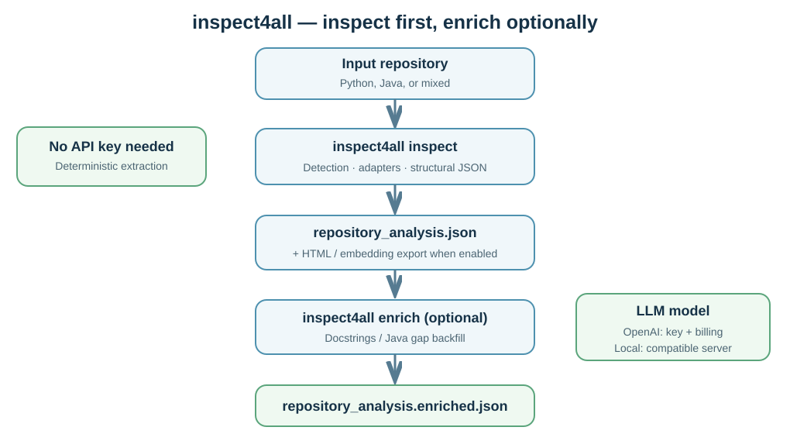
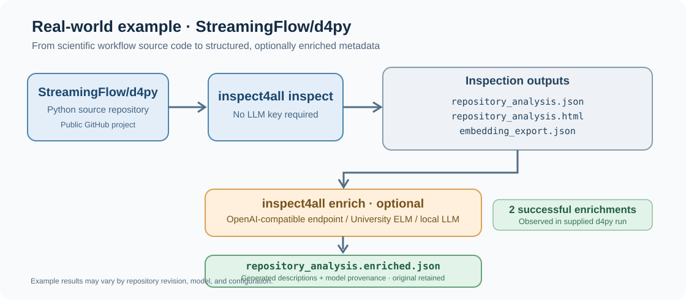
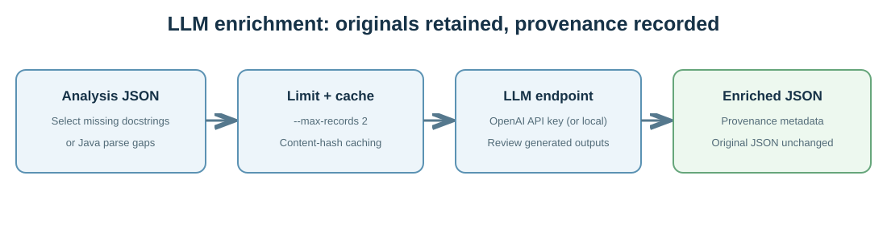

# inspect4all

[](https://python.org) [](LICENSE) 

**Inspect Python and Java code repositories, export structured metadata, and optionally enrich missing documentation using an LLM.** The core inspection is entirely usable **without an OpenAI API key**. LLM enrichment is opt-in and needs an accessible model endpoint (for OpenAI, an API key and API credits).



## Features

- Detect languages using go-enry, parse Python and Java, recover functions, methods, types, dependencies, calls and repository structure.
- Export `repository_analysis.json`, optionally HTML and embedding-ready JSON.
- Optionally generate missing function/method descriptions and backfill Java parse failures with LLMs, retaining the original analysis and provenance metadata.
- Support mixed Python/Java repositories. Other language adapters and similarity reranking are future work, not current CLI features.

## Install from GitHub (verified on macOS Apple Silicon)

**Requirements:** Git, Python 3.12+, [uv](https://docs.astral.sh/uv/), [Go](https://go.dev/) compiler, `make` and a C toolchain (CGo). On macOS you can install Go with Homebrew:

```bash
brew install go
curl -LsSf https://astral.sh/uv/install.sh | sh
```

On Ubuntu/Debian, install Git, Make, a C toolchain and a sufficiently recent Go compiler (distribution package versions vary). Then install uv as above. The Linux path is supported by the Makefile but **has not yet been independently verified** here. Native Windows installation is not yet documented.

**Clone, build the native language detector, and install:**

```bash
git clone https://github.com/SemanticRepoHub/inspect4all.git
cd inspect4all
make libenry
uv tool install --force .
inspect4all --help
inspect4all inspect --help
inspect4all enrich --help
```

> The order matters: `make libenry` builds a platform-specific native library required by the wheel build. **Direct `uv tool install git+https://...` is not yet the recommended method**, because it does not run that native build step automatically. This exact clone/build/install procedure was verified on macOS Apple Silicon on 2 November 2026.

To update your installed source version:

```bash
cd /path/to/inspect4all
git pull --ff-only
make libenry
uv tool install --force .
```

## Test 1: Inspect a repository (NO API key)

**Bundled Python fixture:**

```bash
inspect4all inspect --all -i examples/hello-world-python -o python_inspect
ls -lh python_inspect/
```

**Bundled Java fixture:**

```bash
inspect4all inspect --all -i examples/hello-world-java -o java_inspect
```

**Any local repository:**

```bash
inspect4all inspect --all -i /absolute/path/to/your/repository -o repo_inspect
```

You should see `repository_analysis.json`, `repository_analysis.html`, and `embedding_export.json` with `--all`. In a fresh GitHub source installation, a local d4py checkout was inspected successfully in approximately **4.713 seconds** (one test, not a reproducible performance benchmark).

## Real-world example — inspect and enrich StreamingFlow/d4py

Alongside the bundled Python and Java mini-examples, we provide a **real, reproducible repository inspection** using [StreamingFlow/d4py](https://github.com/StreamingFlow/d4py), an open-source scientific-workflow codebase.



*Note: Example results may vary by repository revision, model, and configuration.*

The diagram distinguishes **static inspection (no API key)** from **optional LLM enrichment (a configured compatible model endpoint and credentials)**. The reported two successful enrichments come from the supplied d4py test output, not an assertion that every run produces identical text.

```bash
git clone https://github.com/StreamingFlow/d4py.git demo-d4py
inspect4all inspect --all -i demo-d4py -o d4py_inspect
```

This completed successfully on macOS Apple Silicon on 2 November 2026 and produced the JSON, HTML and embedding export outputs. Two functions were then enriched with `gpt-5.6-luna` using the optional LLM processor (two successes recorded in the cache):

```bash
inspect4all enrich -i d4py_inspect --max-records 2 --processors docstrings
```

**See [the complete real-world walkthrough and actual before/after metadata](examples/d4py-real-world/README.md)**. An API key is **not** required for inspection; enrichment requires an authorised OpenAI-compatible LLM service and its credentials. The University of Edinburgh ELM gateway may be used if configured and authorised; a University key is not interchangeable with a direct OpenAI API key.

## Test 2: Optional LLM enrichment (OpenAI API key required for OpenAI)



After **Test 1**, you can ask a configured LLM to enrich a small sample. Inspect4all can use an **OpenAI-compatible API**: this can be OpenAI's hosted API, or a compatible local model server. It does **not** automatically provide an OpenAI key or API credits. A ChatGPT subscription is separate from OpenAI API billing.

### Option A — OpenAI

1. Create an API key in your [OpenAI API account](https://platform.openai.com/api-keys), and check that API billing and model access are enabled.
2. Use a **model identifier actually available to your API account**, rather than an older example name.
3. Configure the endpoint and key. The following invisible-key prompt works in macOS **zsh**:

```bash
export INSPECT4ALL_LLM_BASE_URL="https://api.openai.com/v1"
export INSPECT4ALL_LLM_MODEL="YOUR_SUPPORTED_OPENAI_API_MODEL"
export INSPECT4ALL_LLM_MAX_TOKENS=4096
read -s "INSPECT4ALL_LLM_API_KEY?OpenAI API key: "
export INSPECT4ALL_LLM_API_KEY
echo
```

For bash replace the `read -s` line with `read -r -s -p "OpenAI API key: " INSPECT4ALL_LLM_API_KEY`.

**Small, cost-limited example:**

```bash
inspect4all enrich -i python_inspect --max-records 2 --processors docstrings
ls -lh python_inspect/
```

When eligible records are present and the LLM call succeeds, this writes `repository_analysis.enriched.json` and cache files **without overwriting the original**. The outputs contain model-derived documentation and provenance; descriptions need human review.

**Java recovery**, when applicable, uses `--processors java-backfill`. Run `inspect4all enrich --help` for all flags, including `--docstring-target`, `--model`, `--reasoning-effort`, and `--max-records`.

### Option B — Local model, no OpenAI API key

If you run a compatible local endpoint (for example LM Studio), you can use:

```bash
export INSPECT4ALL_LLM_BASE_URL="http://localhost:1234/v1"
export INSPECT4ALL_LLM_API_KEY="lm-studio"
export INSPECT4ALL_LLM_MODEL="YOUR_LOADED_LOCAL_MODEL_ID"
inspect4all enrich -i python_inspect --max-records 2 --processors docstrings
```

The local model must already be running and support the necessary response format; compatibility and quality vary. No OpenAI account or OpenAI key is needed for this option.

**Security and cost:** LLM enrichment may transmit selected source-code snippets to the configured provider. Do not send private code without authorisation. Never commit actual API keys, `.env` files, or tokens. Don't put secrets directly in command arguments or URLs. Start with `--max-records 2` to constrain API usage. When finished, run `unset INSPECT4ALL_LLM_API_KEY`.

## Viewing output and understanding the schema

Inspect the real schema (rather than assuming example fields):

```bash
python3 -m json.tool python_inspect/repository_analysis.json | head -100
```

See [the runnable examples](examples/README.md) and [an explicitly illustrative enrichment example](examples/illustrative-enrichment.json). Model-produced outputs can differ across models and runs.

## Development and documentation

### User documentation

- [User guide](docs/USER_GUIDE.md) — installation and usage
- [Understanding outputs](docs/OUTPUT_FORMATS.md) — JSON, HTML and provenance
- [Evaluation and limitations](docs/EVALUATION.md) — dissertation findings
- [Troubleshooting](docs/TROUBLESHOOTING.md) — common errors
- [Verified d4py enrichment example](examples/d4py-real-world/verified-two-records.json)


- [Complete original technical reference](docs/technical-reference.md) — architecture, CLI flags, internal EIDF/GitLab deployments and release procedures. Some internal instructions are retained for reference and are not the public installation path.
- [Architecture](docs/architecture.md)
- [MSc experiments](experiments/README.md)
- [Contributing](CONTRIBUTING.md)
- [Security reporting](SECURITY.md)
- [Citation](CITATION.cff)

Run local checks after `make libenry`:

```bash
uv sync
uv run pytest tests -q
```

Some live LLM smoke tests require credentials and can incur cost; they are not part of the documented offline example.

## Limitations

Python and Java adapters are implemented; other languages may be detected but not structurally analysed. LLM-generated information is uncertain and optional. Fresh source installation requires a native build; one-command binary distribution and native Windows support are not yet documented as available.

## Documentation

- [User guide](docs/USER_GUIDE.md) — Installation and usage.
- [Output formats](docs/OUTPUT_FORMATS.md) — JSON, HTML and provenance.
- [Technical reference](docs/technical-reference.md) — Architecture, CLI and extension development.
- [Evaluation](docs/EVALUATION.md) — Study design and findings.
- [Evaluation evidence](docs/evaluation-evidence.md) — Detailed supporting evidence.
- [Troubleshooting](docs/TROUBLESHOOTING.md) — Common problems.
- [Legacy GitLab and EIDF deployment](docs/legacy-gitlab-deployment.md) — Historical internal procedures.

## Licence

BSD-3-Clause, see [LICENSE](LICENSE). See repository history and [citation metadata](CITATION.cff) for attribution; third-party example repository licences must also be respected.
