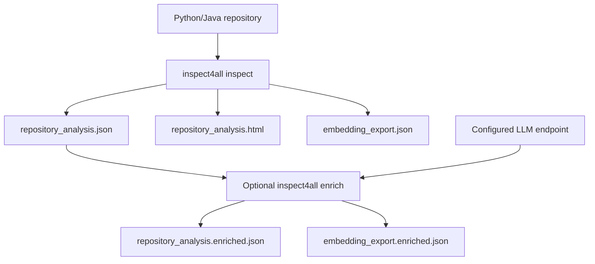

# Output formats and provenance

This page describes **actual keys observed in the user-provided d4py result**; it is not a formal versioned schema specification. Output depends on input repository and inspect4all revision.

## Overview



## Static analysis JSON

Observed top-level members: `repository`, `dependencies`, `license`, `readme_files`, `directory_tree`, `metadata`, `files`, `call_graph`.

- `repository.languages`: file-counts by detected language (**88 Python, 1 Dockerfile, 1 Shell** in the supplied d4py run).
- `repository.software_type`: detected classification (**library** in the d4py run).
- `repository.software_invocation`, `repository.tests`: detected invocation/test candidates; not proof that executing a suggested command succeeds.
- `dependencies`: dependencies and extraction evidence (e.g. build manifests).
- `license`: detected findings and available license file text. In this d4py run `license.detected` was empty even though a license file was present; do not infer absence of licensing.
- `directory_tree`: identified files with language/type labels.
- `files[]`: each record has `file`, `imports`, `types`, `functions`, `main_info`, `language_specific`. `functions` contain source code, qualified names, line ranges and documentation; methods may be nested in types.
- `call_graph`: edges/information keyed by qualified function identifiers.

```bash
python3 -m json.tool d4py_inspect/repository_analysis.json | less
```

## Embedding export

`embedding_export.json` is **embedding-ready textual content**, not evidence that vectors have already been calculated or indexed. The supplied file has `repo_id`, `repo_path`, `readme`, `code_records` and additional record arrays; inspect current keys with:

```bash
python3 - <<'PY'
import json
with open('d4py_inspect/embedding_export.json') as f:
    data=json.load(f)
print(list(data))
print('code records:',len(data.get('code_records',[])))
PY
```

## LLM enrichment

The original JSON is preserved. An eligible function can gain `documentation.enrichments[]` entries containing `source`, `timestamp`, `model`, and a `content` object with generated `short_description`, `params`, and `returns`. A real example excerpt is:

```json
{
  "source": "docstring_enricher",
  "model": "gpt-5.6-luna",
  "content": {
    "short_description": "Builds and returns a workflow graph connecting data sources through correlation, matrix, and maximum-clique processing components.",
    "params": {},
    "returns": "The configured workflow graph."
  }
}
```

See [the verified two-function before/after sample](../examples/d4py-real-world/verified-two-records.json), which retains the actual timestamp and provenance. These are model-produced descriptions, not audited documentation. `enrichment_cache.jsonl` stores IDs, hashes, status and timings so repeated runs may skip the same record. Compare models with fresh/separate output directories.

## Sharing outputs

JSON may embed complete source-code snippets, local paths, historical authors and generated text. Check confidentiality and third-party code licenses before publishing full inspection results. Prefer small redacted examples.
