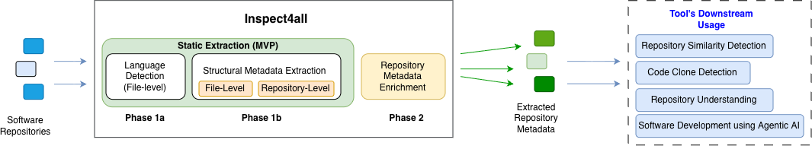
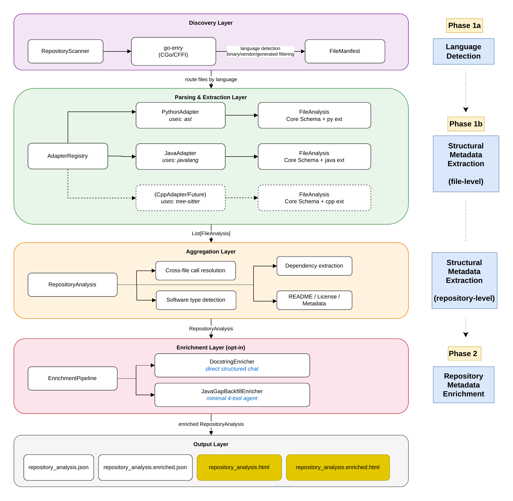
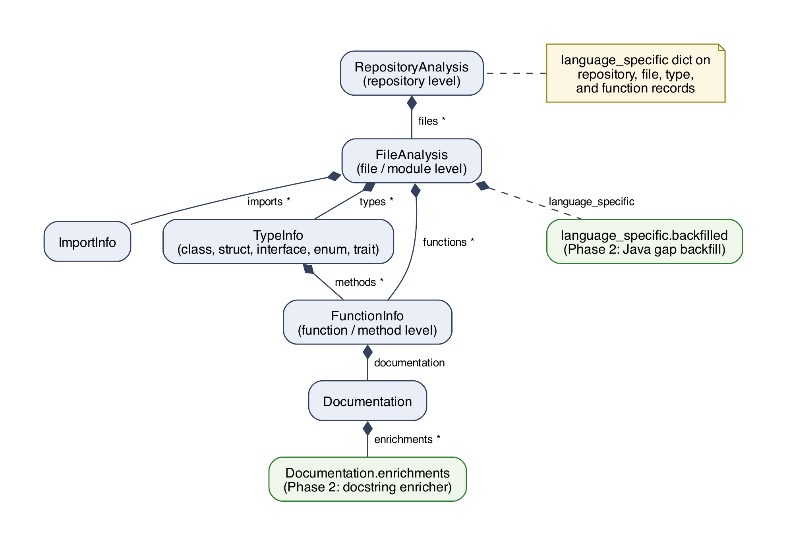
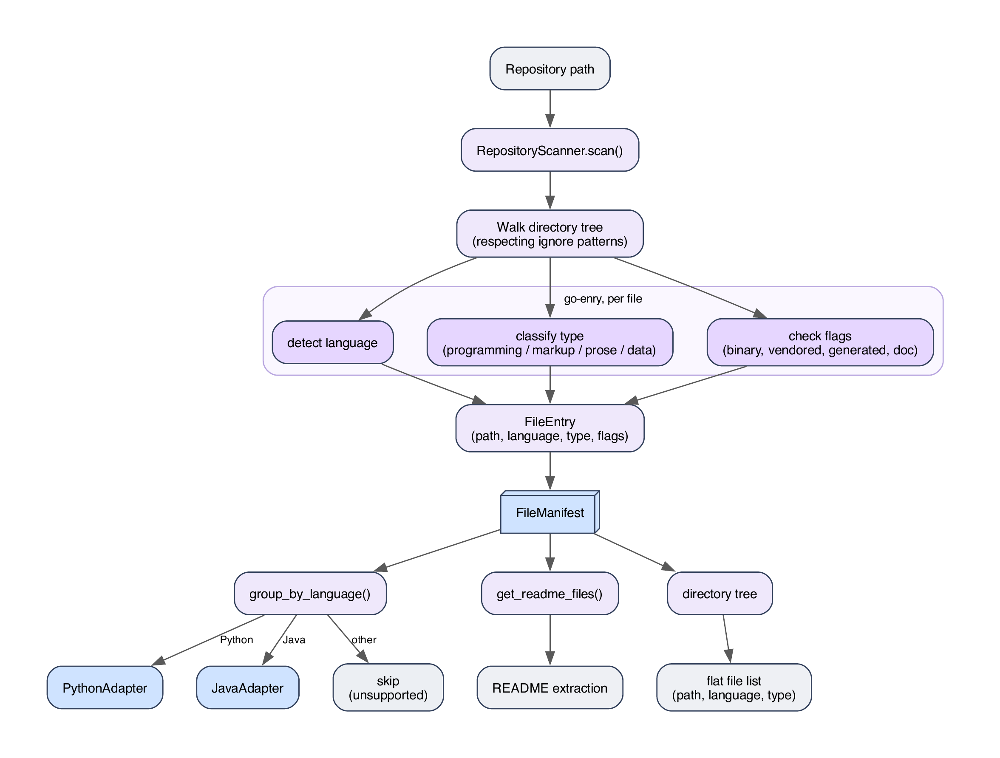
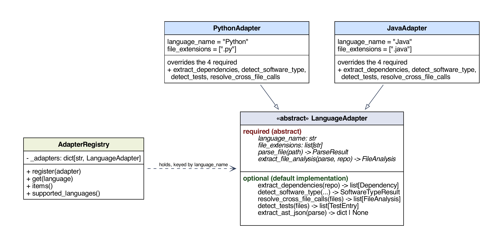

# inspect4all Architecture

inspect4all is a language-agnostic static-analysis tool that turns a software repository into a single, unified JSON document of structural metadata, and can optionally enrich that metadata with LLM-generated content. It is built around **two phases** within a **five-layer pipeline**.

- **Phase 1 — static extraction.** Walks the repository tree, detects each file's language, routes each file to a language-specific adapter, and produces `repository_analysis.json`: functions, types, call graph, dependencies, README text, and licence. No LLM dependency; runs in seconds to low minutes per repository.
- **Phase 2 — agentic AI enrichment (opt-in).** Takes that document and fills two gaps that static analysis leaves — missing documentation, and the structure of Java files that the static parser could not read — writing `repository_analysis.enriched.json`. Incurs LLM cost, so it is opt-in and runs as a separate phase.

*inspect4all in context. Static extraction (Phases 1a and 1b) and repository-metadata enrichment with agentic AI (Phase 2) turn software repositories into unified metadata. Downstream applications ( repository similarity detection) are out of scope (Phase 3, future work); the contribution here is the validated foundation beneath them.*

## Design goals

The architecture is shaped by four explicit goals:

1. **Language extensibility.** One shared pipeline and schema handle multiple languages. Python and Java are the initial targets; a further language is added by writing a single adapter, with no changes to the core pipeline or schema.
2. **Unified metadata output.** The principal artefact, `repository_analysis.json`, captures all extracted structural metadata in a single language-neutral document — one per repository, even when the repository is polyglot.
3. **Provenance separation.** Static extraction and generated content are kept apart. No enricher overwrites extracted fields; each writes to a dedicated, provenance-tagged slot recording the model that produced it, so hallucinations stay auditable and the original extraction stays recoverable.
4. **Clean-room redesign.** [inspect4py](https://github.com/SoftwareUnderstanding/inspect4py) and inspect4j are reference implementations for the Python and Java adapters, not wrappers. The unified schema was designed from first principles to reconcile the structural differences between their outputs.

## Five-layer pipeline

The architecture combines a **five-layer sequential pipeline** with an **adapter-based framework** embedded in the extraction and aggregation layers. Language-specific handling is confined to those two layers; the rest of the pipeline is language-agnostic.

*The five layers - Discovery, Parsing and Extraction, Aggregation, Enrichment, Output - and how they map onto the phases: Discovery performs Phase 1a language detection, Parsing and Aggregation perform Phase 1b file- and repository-level extraction, and Enrichment performs Phase 2.*

Each layer consumes the previous layer's output through a well-defined contract, so language detection, extraction, and enrichment can each be validated separately:

| Layer | Produces |
|-------|----------|
| Discovery | `FileManifest` |
| Parsing & Extraction | `list[FileAnalysis]` |
| Aggregation | `RepositoryAnalysis` |
| Enrichment | the same `RepositoryAnalysis`, enrichment slots filled |
| Output | serialised JSON (and HTML, embedding export) |

**Why a pipeline.** The pipeline needs only one schema, defined before extraction begins. This is combined with an language adapter framework for language agnosticity.

## Unified schema

The unified schema is the core contribution of the extraction pipeline: a language-independent representation of repository metadata, organised as a three-level hierarchy of **function -> file -> repository**.

*High-level schema hierarchy*

- **`RepositoryAnalysis`** holds repository-level metadata: detected languages, software type, dependencies, README text, licence, cross-file call graph, directory tree, and a list of `FileAnalysis`.
- **`FileAnalysis`** — one per source file (a Python module or a Java compilation unit; there is no separate module type) — holds the file's imports, its `TypeInfo` list, and its module-level `FunctionInfo` objects, with path, language, and module docstring carried on its `FileInfo`.
- **`TypeInfo`** covers classes, structs, interfaces, enums, and traits through a `kind` field rather than a language-specific subclass hierarchy.
- **`FunctionInfo`** is the atomic unit: qualified name, parameters, return type, modifiers, source, resolved calls, line range, an `is_constructor` flag, and a `documentation` field.
- **`Documentation`** holds the parsed docstring parts and an `enrichments` list — the attachment point for Phase 2 output.

**Core-plus-payload.** Rather than reproduce every construct of every language, inspect4all keeps a small, stable core of the structural elements mainstream languages share and pushes everything language-specific into a `language_specific` dictionary on the repository, file, type, and function records. This open-vocabulary escape hatch preserves idiosyncratic features (a Python function's `is_async` flag, a Java enum's constant list, a Rust lifetime) as plain JSON key-values without growing the shared schema. A compact fixed core is easier to keep stable, query, and extend; the schema is validated on two structurally different languages (Python and Java), and a further language is added through one adapter with its unique features in the payload. (This is similar to RISC vs CISC)

### Schema design decisions vs. predecessors

Five deliberate decisions depart from inspect4py and inspect4j:

| Aspect | Predecessors | inspect4all | Rationale |
|--------|--------------|-------------|-----------|
| Container type | Dict keyed by name, `{"f": {…}}` | List, `[{…}]` | Keeps overloaded methods a name-keyed map silently drops |
| Qualified name | Implicit dict key (short name) | Explicit `qualified_name` per type and function | Enables cross-file call resolution |
| Dependency model | Language-specific record (Python or Java) | Single unified `Dependency` | Makes dependencies comparable across languages |
| Language field | Absent (single-language) | `language` on every file | Identifies each file's language |
| Enrichment slot | Absent | `Documentation.enrichments` and `language_specific.backfilled` | Stores Phase 2 output without overwriting extraction |

## Discovery layer — language detection

The Discovery layer walks the directory tree and assigns each file a language label, a file-type classification, and a set of filter flags. Its output is a `FileManifest`, an in-memory list of per-file records that the pipeline partitions by language for adapter routing.

*`RepositoryScanner` walks the tree; go-enry assigns a language and type to each file; filter functions exclude binary, vendored, and generated files; the resulting `FileManifest` is partitioned by language for adapter routing.*

- **Three exclusion filters** run before any file reaches extraction. **Binary** files contain no parsable source. **Vendored** files (third-party code bundled under `vendor/`, `node_modules/`, etc.) are not the repository's own code. **Generated** files (auto-generated parsers, compiled protobuf output) are excluded for the same reason.
- **Language detection** is provided by **go-enry**, loaded through the C Foreign Function Interface (CFFI) as a platform-specific shared library built at a pinned tag (`libenry.so` on Linux, `libenry.dylib` on macOS). CFFI is used over subprocess invocation so the library is loaded once at import and called in-process, avoiding a Go process per file - which matters for repositories with thousands of files.
- Files that pass the filters but have **no registered adapter** are recorded under `metadata.unhandled_files` rather than silently dropped.

## Adapter framework and registry

The adapter framework is the primary extensibility mechanism for language-specific operations. It is used in two layers: during **extraction** each adapter parses files in its language and resolves cross-file calls within that language group; during **aggregation** adapters provide dependency extraction and software-type detection. The discovery, enrichment, and output layers do not use the registry and operate on the unified schema directly.

*The `LanguageAdapter` abstract base class, `AdapterRegistry`, and the Python and Java concrete adapters. The pipeline interacts only with the abstract interface; language-specific parsing is encapsulated within each adapter.*

Every adapter implements the `LanguageAdapter` abstract base class in `core/interfaces.py`:

- **Four required methods:** `language_name`, `file_extensions`, `parse_file(path) -> ParseResult`, and `extract_file_analysis(result, repo_path) -> FileAnalysis` — the parse-then-extract pattern used by both current adapters.
- **Five optional methods** with default no-op implementations: `extract_dependencies`, `detect_software_type`, `resolve_cross_file_calls`, `detect_tests`, and `extract_ast_json`. An adapter can ship without them and the pipeline still functions; both current adapters override all four of the optionals they use.

Adapters are registered in `AdapterRegistry`, a dictionary keyed by the go-enry language label. A single function, `build_default_registry()`, registers all built-in adapters. **Adding a language requires implementing one adapter and adding one registration line** — no other part of the pipeline changes. Swapping an adapter's parser (e.g. replacing javalang with a Java-9+-capable parser) is likewise confined to that adapter package.

**Failure handling, and why it lives in the pipeline.** A parser can fail on individual files, most often when javalang meets post-Java-8 syntax. Rather than abort, the pipeline catches the failure, logs it, and records the file's path under `metadata.parse_failures` before continuing. Capturing this in the pipeline rather than inside an adapter keeps it language-agnostic — and the recorded list becomes **the interface between the two phases**: the `JavaGapBackfillEnricher` reads `parse_failures` in Phase 2 to target exactly the files static parsing could not handle. Separately, the Python adapter rejects content go-enry misclassifies as Python (Cython, Jinja/Django templates, Dockerfiles with Python-like extensions, Python 2) and records it under `unhandled_files`, kept out of `parse_failures` so the backfill agent is never sent after files it can never recover.

## Aggregation layer — repository-level extraction

The Aggregation layer is deliberately language-agnostic: it performs no parsing and holds no language-specific knowledge. It orchestrates the repository-level operations that adapters expose — dependency extraction, software-type detection, test detection, cross-file call resolution — and combines their results with README extraction, licence detection, and directory-tree construction into a single `RepositoryAnalysis`.

The repository-level techniques follow the predecessor tools:

- **Dependencies** are language-specific and handled per adapter — Python requirement/setup files as inspect4py does, Java `pom.xml` and Gradle files as inspect4j does.
- **Software type** (library, package, or script) is inferred from package markers, build files, and entry points, following inspect4py; **README** collection likewise.
- **Licence** detection scores the `LICENSE` text against SPDX templates by Dice-coefficient similarity, recording the highest match above a **0.9** threshold as the primary licence.

## Enrichment pipeline (Phase 2)

The enrichment layer is organised around an `EnrichmentProcessor` abstract base class with a single method, `enrich(repo) -> RepositoryAnalysis`. Each processor is a **pure transformation**: it receives a `RepositoryAnalysis` and returns a modified copy without mutating the original. An `EnrichmentPipeline` chains processors in sequence; failed or timed-out records are logged and skipped, never aborting the run.

**Matching technique to task.** The two enrichers use different techniques because their tasks differ — an agent is used only where tool use is genuinely required, otherwise a single direct prompt. Both were first built as ReAct agent loops; the switch away from the loop for docstrings, after weighing effectiveness against token cost and processing time, is reported as a finding in the dissertation.

### DocstringEnricher — Direct LLM generation

Targets functions where `documentation` is `None` or `full_text` is empty. With the signature and body already in context, it needs **no tools**, so the design is **one structured LLM chat call per record**. A language-specific system prompt asks for a JSON object with three fields — `short_description`, `params`, `returns` — Java targets receiving a Javadoc-style prompt and Python targets a Google-style prompt; one retry is issued on malformed output.

Functions are processed **callee-before-caller**, ordered by a topological sort on the resolved call graph, so each caller receives the documentation of up to eight direct callees as prompt context (sourced from Phase 1 extraction or from enrichments generated earlier in the run). This follows DocAgent's dependencies-first strategy, realised by reusing the Phase 1 call graph rather than building a separate dependency graph.

### JavaGapBackfillEnricher — minimal 4-tool agent

Targets the Java files recorded in `parse_failures` — those javalang could not parse. Here tool use is genuinely required. The agent does not parse the source itself; it calls a tree-sitter-backed tool to parse the raw source into a CST, navigates that CST, and emits a validated `FileAnalysis`. The design narrowed to exactly **four task-specific tools** over three iterations (generating tree-sitter code directly, then abstracting the parse behind a tool, then the final four):

| Tool | Purpose |
|------|---------|
| `tree_sitter_parse()` | Returns CST JSON for the source |
| `read_source_slice(start, end)` | Returns raw source lines |
| `emit_file_analysis(payload)` | Validates the payload against the `FileAnalysis` schema and writes it to a collector |
| `check_completeness()` | Verifies the emitted analysis against a **deterministic** tree-sitter ground truth |

The fourth tool closes a **verification loop inside the agent**: after each emission it compares the emitted `FileAnalysis` against a structure derived directly from the tree-sitter parse — confirming every declared type is present, its kind is correct (record, sealed class, interface, enum), a sealed type carries the `sealed` modifier, and record components and method names are all accounted for — returning either `COMPLETE` or a prioritised list of gaps to fix and emit again. Unlike DocAgent's Writer–Verifier design (a second model reviews the output), the verifier here is deterministic, targeting exactly the post-Java-8 constructs most likely to be missed. The harness is a plain LangChain `create_agent` carrying only those four tools, chosen after a ready-made agent harness (deepagents) drew the model into exploring irrelevant tools.

### Model configuration and cost

The enrichers call the LLM through an **OpenAI-compatible chat-completions endpoint**, so any provider exposing one is supported — hosted OpenAI or a local LM Studio server. Endpoint, model, and generation parameters are set via environment variables or CLI flags, not code, which is what lets the same pipeline run against a hosted API or a local model.

Enriching a single repository can take minutes, so always-on enrichment is impractical. Enrichment is therefore **opt-in** (the `--enrich` flag), **caches** completed work by content hash, and runs as a **phase separate** from extraction.

## Cache, backoff, and provenance

Three cross-cutting concerns support the enrichment pipeline:

- **Cache.** A JSONL file where each line records a `record_id`, a SHA-256 `content_hash` of the record's source, and a status. A cache hit is used **only if the stored hash matches the current source**, so source changes trigger re-enrichment automatically. Its rationale is cost control, not speed: without it, a partial failure or a single source-file change can re-invoke hundreds of LLM calls on unchanged content.
- **Backoff.** Exponential delay on all API calls, retrying transient provider errors up to twice (after one and two seconds), with no external dependencies. Non-transient errors (e.g. exhausting the tool-turn budget) are not retried.
- **Provenance.** Each enricher's output is written to a dedicated slot — `Documentation.enrichments` for docstrings, `language_specific.backfilled` for backfill — so extracted fields are **never overwritten**.

## Output formats

The assembled `RepositoryAnalysis` is serialised to three kinds of artefact:

- **`repository_analysis.json`** — the principal unified document; after a Phase 2 run the same serialiser writes **`repository_analysis.enriched.json`** with the enrichment slots filled and the schema otherwise unchanged.
- **HTML render** — a self-contained, browsable view of the same document, following inspect4py's HTML report.
- **`embedding_export.json`** — flattens the document into a vector-ready record list for the intended Phase 3 similarity pipeline (a language-agnostic version of RepoSim4Py, future work). Each record carries static, generated, or combined text under an `ORIGINAL`, `ENRICHED`, or `COMBINED` mode; a matching `embedding_export.enriched.json` is produced after enrichment.
