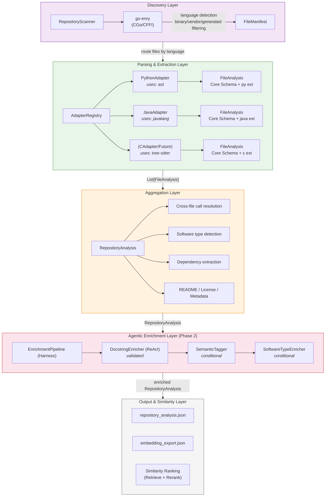

# inspect4all High Level Architecture

inspect4all is a language-agnostic static analysis tool for inspecting and understanding software repositories. It produces structured metadata optimised for multi-level code embedding generation and repository understanding tasks.

## Overview

The system follows a layered pipeline architecture where each stage transforms the data toward a richer representation. The current implementation focuses on **Python and Java** repositories. The **adapter framework and interfaces** ensure extensibility, making it straightforward to add support for other languages or swap existing parsers (e.g., from `javalang` to `tree-sitter`).




## Functional Layers

1.  **Discovery** — Traverses the repository, classifies every file by language/type using **go-enry**, and produces a `FileManifest` for routing. It filters out binary, vendored, and generated files.
2.  **Parsing & Extraction** — Language-specific adapters parse each source file into a unified core schema.
    - **PythonAdapter**: Uses the standard library `ast` module.
    - **JavaAdapter**: Uses `javalang` (targeting Java 8).
    - **Adapter Registry**: Routes files to the correct adapter based on language detection.
3.  **Aggregation & Baseline Similarity** — Combines per-file results into a `RepositoryAnalysis` and computes baseline similarity scores. This stage resolves cross-file call graphs, extracts dependencies, and performs initial embedding-based similarity ranking.
4.  **Agentic Enrichment** — An AI-powered pipeline that augments extracted metadata using Large Language Models (LLMs). This layer addresses gaps like missing documentation or unparsed constructs.
5.  **Agentic Reranking** — A high-precision reranking agent that rescores the top-k results by reasoning over the structured JSON metadata, providing explainable and higher-precision rankings.

## Unified Schema

The core of `inspect4all` is a unified metadata schema designed for cross-language comparability. 

At the repository level, the output will captures repository metadata (languages, software type, invocation entry points), license, README files, directory structure, cross-file call graphs, and hosting platform (e.g. github) metadata.

### Sample Output Schema (`repository_analysis.json`)

An example output schema for repository level metadata:

```json
{
  "repository": {
    "path": "...",
    "languages": {"Python": 42, "Java": 18},
    "software_type": "library",
    "software_invocation": [...],
    "tests": [...]
  },
  "dependencies": [...],
  "license": {
    "detected": [{"type": "MIT", "confidence": 0.95}],
    "source_files": ["LICENSE"],
    "text": "..."
  },
  "readme_files": [{"path": "README.md", "content": "..."}],
  "directory_tree": [
    {"path": "src/main.py", "language": "Python", "type": "source"},
    {"path": "pom.xml", "language": null, "type": "build"}
  ],
  "metadata": { ... },
  "files": [ ... ],
  "call_graph": { ... }
}
```

### Core Language Structure (Per-Source File)

At the per-file level, the following four primary structures are used across programming languages:

- **FunctionInfo**: Function/Method signatures, parameters, return types, call targets, and source code.
- **TypeInfo**: Classes, interfaces, and enums, including their methods and fields.
- **Documentation**: Docstrings and Javadoc normalized into a consistent format.
- **Dependency**: Library dependencies extracted from build configurations or imports.

Each structure includes a `language_specific` extension field to preserve details unique to a language (e.g., Python decorators or Java annotations).

### Sample Per-File Output (within `files[]`)

```json
{
  "file": {
    "path": "src/utils/data_loader.py",
    "name": "data_loader",
    "extension": ".py",
    "language": "Python",
    "package": "src.utils",
    "documentation": {
      "short_description": "Utilities for loading and transforming datasets.",
      "long_description": null,
      "full_text": "Utilities for loading and transforming datasets.",
      "params": {},
      "returns": null,
      "raises": [],
      "tags": {},
      "enrichments": null
    },
    "is_test": false
  },
  "imports": [
    {"module": "pathlib", "name": "Path", "alias": null, "is_internal": false, "kind": "class"},
    {"module": "src.config", "name": "Config", "alias": null, "is_internal": true, "kind": "class"}
  ],
  "types": [
    {
      "kind": "class",
      "name": "DataLoader",
      "qualified_name": "src.utils.data_loader.DataLoader",
      "documentation": {
        "short_description": "Load datasets from disk.",
        "long_description": null,
        "full_text": "Load datasets from disk.",
        "params": {},
        "returns": null,
        "raises": [],
        "tags": {},
        "enrichments": null
      },
      "source_code": "class DataLoader:\n    ...",
      "base_classes": ["BaseLoader"],
      "interfaces": [],
      "modifiers": [],
      "annotations": [],
      "fields": [
        {"name": "root_dir", "type": "Path", "modifiers": [], "default_value": null, "annotations": []}
      ],
      "methods": [
        {
          "name": "load",
          "qualified_name": "src.utils.data_loader.DataLoader.load",
          "documentation": {
            "short_description": "Load a dataset by name.",
            "long_description": null,
            "full_text": "Load a dataset by name.\n\nArgs:\n    name: Dataset identifier.\n\nReturns:\n    Loaded dataset as a dictionary.",
            "params": {"name": {"description": "Dataset identifier.", "type": "str"}},
            "returns": {"description": "Loaded dataset as a dictionary.", "type": "dict"},
            "raises": [{"type": "FileNotFoundError", "description": "If dataset path does not exist."}],
            "tags": {},
            "enrichments": null
          },
          "source_code": "def load(self, name: str) -> dict:\n    ...",
          "parameters": [
            {"name": "self", "type": null, "default": null, "is_optional": false, "annotations": []},
            {"name": "name", "type": "str", "default": null, "is_optional": false, "annotations": []}
          ],
          "return_type": "dict",
          "modifiers": [],
          "annotations": [],
          "calls": ["pathlib.Path", "json.load"],
          "line_range": [15, 28],
          "is_constructor": false,
          "nested_functions": [],
          "language_specific": {}
        }
      ],
      "line_range": [8, 28],
      "language_specific": {
        "decorators": []
      }
    }
  ],
  "functions": [],
  "main_info": null,
  "language_specific": {
    "body_calls": []
  }
}
```

### Key Schema Differences from inspect4py/inspect4j

| Aspect | inspect4py/inspect4j | inspect4all |
|---|---|---|
| File grouping | Dict keyed by directory path | `"files": [...]` list with path on each file |
| Types/Classes | `"classes": {"Name": {...}}` dict | `"types": [{"kind": "class", ...}]` list |
| Functions | `"functions": {"name": {...}}` dict | `"functions": [{"name": "...", ...}]` list |
| Methods | `"methods": {"name": {...}}` dict | `"methods": [{"name": "...", ...}]` list |
| Dependencies | `"requirements": {"pkg": "ver"}` (Python) / `"requirements": {"pkg": {"version", "scope"}}` (Java) | `"dependencies": [{name, version, source, scope, language, build_tool}]` unified |
| Docstring params | `"doc.args"` | `"documentation.params"` |
| Type annotations | Separate `annotated_arg_types`, `annotated_return_type` | Merged into `parameters[].type` and `return_type` |
| `store_vars_calls` | Present on functions/methods | Removed (internal to adapters) |
| `body` (Python) | Top-level field | `language_specific.body_calls` |
| Line numbers | `"min_max_lineno": {"min": N, "max": N}` | `"line_range": [N, N]` |
| Qualified name | Implicit (in calls) | Explicit `qualified_name` on every function/type |
| Source code | Only with `-sc` flag | Always present (needed for CODE embeddings) |
| Annotations | Java: separate `annotations` array | Core: `annotations: list[str]` (names only). Full details in `language_specific` |
| Language field | Not present (assumed) | Explicit on every file |
| Package field | Java only | On every file (Python module path, Java package) |
| Directory tree | Nested dict (inspect4j) / flat dict (inspect4py) | Flat file list with metadata |
| License | `[{"MIT": "95.2"}]` | `[{"type": "MIT", "confidence": 0.952}]` |
| README | `{"path": "content"}` dict | `[{"path": "...", "content": "..."}]` list |
| Enrichments | Not present | `Documentation.enrichments` on every doc object |

## Agentic Enrichment Architecture

The enrichment layer is built using an **Agentic Harness** patterns to ensure reliability and auditability:

### ReAct-style Loop
Enrichers (like the `DocstringEnricher`) follow the **ReAct** (Reasoning + Acting) pattern. The agent interleaves reasoning with tool use in a **Thought-Action-Observation** loop:
- **Thought**: Assess missing or weak metadata.
- **Action**: Invoke tools (e.g., RAG over codebase, generate docstring).
- **Observation**: Validate the generated content.

### Agentic Harness
The system infrastructure manages the agents through two layers:
- **Scaffolding**: Prepares system prompts, tool schemas, and agent registries.
- **Harness/Dispatch**: Manages runtime tool execution, ensures safety, and handles retries (Reflexion pattern).

Two candidate frameworks for the harness implementation:
- **LangGraph**: Explicit graph-based control flow. More control over the ReAct loop, validation gate, and retry edges. Used in Experiments 5 and 6.
- **LangChain deep agents** (e.g. `create_react_agent`): Provides the ReAct harness out of the box, less scaffolding code. A good fit if the CRAG validation and Reflexion retry can be expressed as tool calls rather than explicit graph edges.

### Provenance Tagging
All enriched fields carry a provenance tag to distinguish parser-extracted facts from AI-generated content:
- `tool`: Extracted directly by a static parser. Treated as ground truth.
- `agent_validated`: Generated by an agent and validated through the CRAG confidence gate.
- `agent_unvalidated`: Generated by an agent but failed validation after retries exhausted.

> **Note:** The feasibility study Experiment 5 prototype used `agent_enriched` and `agent_backfill_unvalidated`. `agent_validated` / `agent_unvalidated` are the finalised labels for the dissertation implementation.