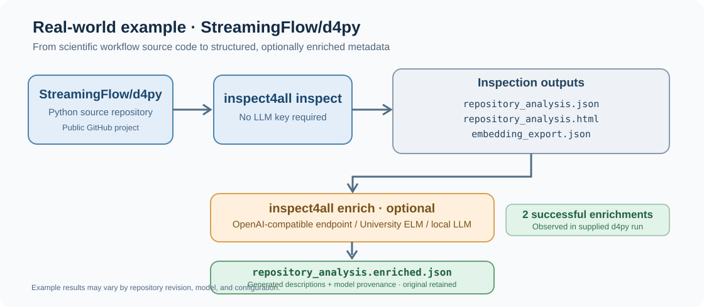

# Real-world example: StreamingFlow/d4py

This example uses the public [StreamingFlow/d4py](https://github.com/StreamingFlow/d4py) codebase, **not** a synthetic fixture. On 2 November 2026, inspect4all successfully inspected the checkout on macOS Apple Silicon and enriched two undocumented Python functions using `gpt-5.6-luna` through a configured OpenAI-compatible API.



## Reproduce inspection

From your inspect4all clone after following the main README installation steps:

```bash
mkdir -p demo-repositories
git clone https://github.com/StreamingFlow/d4py.git demo-repositories/d4py
inspect4all inspect --all -i demo-repositories/d4py -o d4py_inspect
ls -lh d4py_inspect
```

Expected filenames include `repository_analysis.json`, `repository_analysis.html`, and `embedding_export.json`. The original local test completed in 4.713 seconds, **not** a benchmark guarantee. Counts, output content and timings may differ with the revision of d4py and inspect4all; pin commits for a scientific replication.

## Reproduce optional enrichment

Set `INSPECT4ALL_LLM_BASE_URL`, `INSPECT4ALL_LLM_MODEL`, and `INSPECT4ALL_LLM_API_KEY` as explained in the main README; **do not commit any API key**. University-managed OpenAI-compatible gateways require their own base URLs and service-specific model IDs.

```bash
inspect4all enrich -i d4py_inspect --max-records 2 --processors docstrings
```

Inspect the new `repository_analysis.enriched.json`. The checked-in [`enrichment-before-after.json`](enrichment-before-after.json) contains a **small, real excerpt** of the two records produced in the supplied run, not the entire analysis and not a fixture asserting model output must be byte-identical. Model outputs can differ between runs.

## Interpretation

Both records in the provided run were successful according to `enrichment_cache.jsonl` (no failed records). The generated descriptions are stored under `documentation.enrichments` with source, model and timestamp provenance. Original repository source and original analysis are retained. Inspect4all sends relevant code context to the model provider during enrichment: only use repositories that are permitted by the provider and your organisation's data rules.

The source d4py repository remains governed by its own license. This repository includes only a short generated metadata excerpt; it does not redistribute the full d4py source tree.
