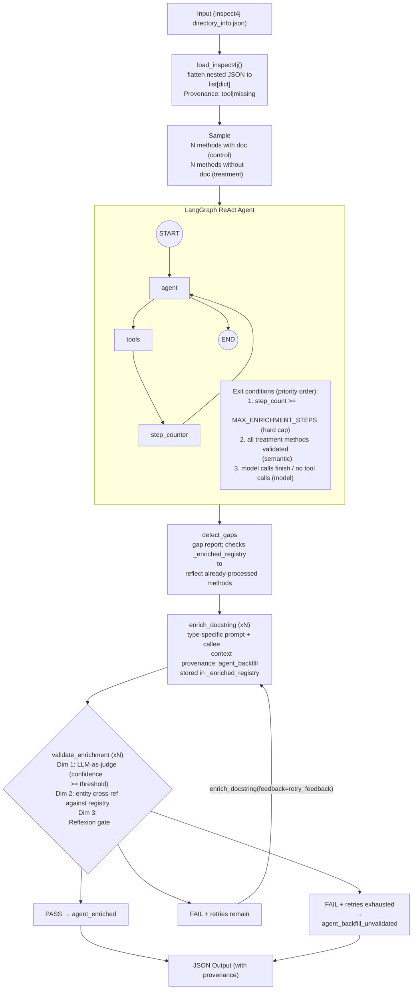

# Preliminary Investigations on Agentic Enrichment

This section touches on the experimentation done to explore the use of agentic AI for structural metadata preprocessing and enrichment. The exploration is motivated by **RQ2**: *Does agentic enrichment of extracted structural metadata improve cross language repository similarity ranking accuracy compared to unenriched metadata?*

Multiple Notebooks are provided:

- [`enrichment.ipynb`](./enrichment.ipynb) -- pipeline backed by OpenAI GPT (cloud)
- [`enrichment-local.ipynb`](./enrichment-local.ipynb) -- same pipeline adapted for LM Studio (local Qwen 3 that is released in 2025, via OpenAI-compatible API )
- [`enrichment-local-qwen35.ipynb`](./enrichment-local-qwen35.ipynb) -- same pipeline adapted for LM Studio (local Qwen 3.5 27B, an improved local llm model released in 15 Feb 2026, via OpenAI-compatible API )

## Setup

Ensure `uv` (https://docs.astral.sh/uv/) is installed as the notebooks are in a Python virtual environment managed by `uv`.

```sh
# run sync to sync the environment with all dependencies according to the lock file
uv sync
```

## Running the Notebooks

Launch Jupyter and open the desired notebook:

```sh
uv run jupyter notebook
```

The following notebooks are available:

- `enrichment.ipynb` — main agentic enrichment pipeline (cloud model)
- `enrichment-local.ipynb` — enrichment pipeline using a local model
- `enrichment-local-qwen35.ipynb` — enrichment pipeline using Qwen 3.5 local model (test for newer model post feasibility study)

Then run all cells in order via **Cell > Run All**. See the configuration cell near the top of each notebook to set model and pipeline parameters before running.

For `enrichment.ipynb`, create a `.env` file with:

```sh
OPENAI_API_KEY=sk-...
```

For `enrichment-local.ipynb` and `enrichment-local-qwen35.ipynb`, start LM Studio, load a Qwen model, and enable the local server on port 1234. No API key is required.

---

## Agentic Pipeline Architecture

The pipeline follows the **ReAct pattern** (Yao et al., 2022) -- a Thought -> Action -> Observation loop implemented via LangGraph. Three quality mechanisms are layered on top:

- **CRAG-style confidence gate** (Yan et al., 2024) -- LLM-as-judge validation before finalising a docstring
- **Reflexion-style retry** (Shinn et al., 2023) -- verbal feedback passed back to `enrich_docstring` on validation failure
- **DocAgent principles** (Feng et al., 2024) -- component-type-specific prompts, dependency context from already-enriched callees, truthfulness cross-reference

### Tools Registered

| Tool | Purpose | Theory |
| ---- | ------- | ------ |
| `detect_gaps` | Structured gap analysis -- missing doc, weak doc, javalang parse failures; enriched-registry-aware on repeat calls | ReAct |
| `enrich_docstring` | Component-type prompt + callee dependency context + optional Reflexion feedback | DocAgent, CRAG, Reflexion |
| `validate_enrichment` | Three-dimensional check: helpfulness (LLM-judge) + truthfulness (entity cross-ref) + Reflexion retry gate | CRAG, Reflexion, DocAgent |
| `finish` | Signal enrichment complete | -- |

### Gap Taxonomy

`detect_gaps` classifies each method into one or more gap types:

| Gap Type | Meaning |
| -------- | ------- |
| `missing_docstring` | No documentation at all |
| `weak_docstring` | Description exists but under 30 characters |
| `missing_return_type` | `null` return type -- javalang parse failure on Java 9+ generics |
| `unparsed_construct:<name>` | Spring/Lombok annotation javalang cannot resolve |

### Processing Flow



---

## Design Decisions

### Registry Pattern

Tools never accept a full method `dict` as an argument. All method data lives in server-side registries keyed by method ID:

```
_method_registry  : dict[str, dict]  -- ground-truth from inspect4j (read-only)
_enriched_registry: dict[str, dict]  -- enriched output (written by enrich_docstring,
                                         updated by validate_enrichment)
_retry_registry   : dict[str, int]   -- Reflexion retry counter per method (P68)
```

This eliminates a class of LLM hallucination where the model reconstructs partial or incorrect dicts when calling tools.

### Provenance Chain

Every method carries a `provenance` field that tracks documentation origin throughout the pipeline:

```
missing  --> agent_backfill --> agent_enriched           (validated pass)
                             -> agent_backfill_unvalidated (retries exhausted)

tool                                                      (original from inspect4j)
```

This provenance chain enables fine-grained ablation in the RQ2 evaluation -- embeddings can be compared at each stage of enrichment.

### Component-Type-Specific Prompts (DocAgent)

`enrich_docstring` classifies each method into one of four types and uses a tailored prompt:

| Type | Detection | Guidance emphasis |
| ---- | --------- | ----------------- |
| `constructor` | method name == class name | initialised state, parameter semantics, exceptions |
| `test` | `@Test` annotation or `test`/`should` prefix | verified behaviour, expected outcome, implied scenario |
| `static` | `static` modifier | computation performed, input constraints, return value |
| `instance` | fallback | operation on object state, parameter roles, return value |

### Dependency Context (DocAgent)

Before enriching method A, `enrich_docstring` looks up `_enriched_registry` for any of A's called methods and prepends their already-enriched docstrings as grounding context. This implements DocAgent's *Dependencies First* principle (providing concrete context reduces hallucination and improves specificity with Reflexion).

### Truthfulness Cross-Reference (DocAgent + Reflexion)

`validate_enrichment` extracts code entity references from the generated docstring (`{@link Foo}`, `UpperCamelCase`, backtick refs) and cross-references them against `_method_registry`. Each unverified entity reduces the confidence score by 0.1, penalising hallucinated class or method names.

### Reflexion Retry Gate (Reflexion)

When validation fails and retries remain, `validate_enrichment` returns `retry_recommended=True` with a `retry_feedback` string summarising the issues. The agent is instructed to call `enrich_docstring(method_id, feedback=retry_feedback)`, which appends the feedback to the prompt. This mirrors Shinn et al.'s verbal reinforcement loop. `_retry_registry` tracks attempts per method; once `MAX_RETRY_ENRICHMENT` is reached, the method is finalised as `agent_backfill_unvalidated`.

### Idempotency Guards

Both `enrich_docstring` and `validate_enrichment` check the current provenance before executing. If a method has already reached a final state (`agent_enriched` or `agent_backfill_unvalidated`), the tool returns a `SKIP` message immediately. This prevents redundant processing when the model re-calls a tool on an already-finalised method.

`detect_gaps` is also enriched-registry-aware: on repeat calls, already-finalised methods are reported as `[done]` rather than re-listed as gaps, giving the agent accurate state throughout the session.

### Model-Agnostic Exit Condition

The `should_continue` router checks `_enriched_registry` directly to determine if all treatment methods have reached final provenance. This decouples pipeline termination from the model's ability to call `finish`.

### Per-Method Run (Local Model Adaptation)

Cloud models (GPT) self-orchestrate a full multi-method batch in a single agent invocation. Some local models such as Qwen 3 cannot reliably maintain multi-method state across many tool calls -- they loop, re-examine completed methods, and exhaust the step budget before processing all methods.

For `enrichment-local.ipynb`, cell-15 runs **one agent invocation per treatment method**, each with a focused 4-step prompt scoped to a single method ID. The LangGraph graph, all tools, and quality mechanisms are identical; only the orchestration scope per call is narrowed.

```
Cloud (enrichment.ipynb):
  graph.invoke(all 10 methods)  --> 3 steps total (GPT parallel batching)

Local (enrichment-local.ipynb):
  for method in treatment_methods:
      graph.invoke(1 method)    --> ~3-5 steps per method
```

---

## Configuration

Both notebooks expose pipeline parameters in a dedicated config cell:

| Parameter | GPT default | Qwen default | Purpose |
| --------- | ----------- | ------------ | ------- |
| `MAX_ENRICHMENT_STEPS` | 20 | 50 | Hard step cap per agent invocation |
| `MAX_RETRY_ENRICHMENT` | 2 | 1 (2 for Qwen 3.5) | Max Reflexion retries per method |
| `VALIDATION_CONFIDENCE_THRESHOLD` | 0.7 | 0.6 | Minimum confidence to pass validation |
| `SAMPLE_SIZE_EACH` | 5 | 5 | Methods per group (control + treatment) |

---

## Experiment Results

The pipeline was run on a sample of 10 methods from the `java-jwt` repository (5 control, 5 treatment) using two model backends.

### Provenance Breakdown

| Model | Run mode | Methods Enriched | `agent_enriched` | `agent_backfill_unvalidated` | Total Steps |
| ----- | -------- | --------------- | ---------------- | ---------------------------- | ----------- |
| GPT-5.4 (OpenAI) | Single batch | 5 / 5 | 5 | 0 | 3 |
| Qwen 3 (LM Studio) | Per-method | 5 / 5 | varies | varies | 12 |
| Qwen 3.5 (LM Studio) | Single batch | 5 / 5 | 5 | 0 | ~11 |

### Qualitative Comparison

| Aspect | GPT-5.4 | Qwen 3 | Qwen 3.5
| ------ | ------- | ------ | ------ |
| Javadoc conventions | Uses `{@link}`, `{@code}` cross-references | Plain prose only | Plain prose only |
| Description conciseness | 1-2 focused sentences | 1-2 sentences (prompt-constrained) | 1-2 focused sentences |
| Orchestration | Parallel tool batching, clean finish (5 steps) | Per-method runs required for reliability | Sequential tool run, clean finish (11 steps)
| Self-consistency (judge) | High | Lower; some methods fail validation | High
| Dependency context use | References callees accurately | Weaker callee grounding | References callees accurately |

---

## Conclusion from Experiment

The ReAct pipeline with DocAgent-inspired enrichment is functional and produces contextually accurate docstrings for undocumented Java methods. Several conclusions emerge:

1. **Model capability is a confound but gap between Frontier and local model is narrowing.** GPT-5.4 and Qwen 3 produce measurably different output in both pipeline reliability and docstring quality. However, Qwen 3.5 has similar enrichment quality as GPT-5.4 with the samples tested. RQ2 evaluation should control for model when comparing enriched vs non-enriched embeddings.

2. **Some Local LLMs require task decomposition, not just parameter tuning.** Raising step budgets and adding idempotency guards alone were insufficient. It is found that the older Qwen 3's fundamental limitation is multi-method orchestration, not step count. Per-method scoping is the reliable solution.

3. **Provenance enables multi-condition ablation.** The three-state chain (`tool`, `agent_enriched`, `agent_backfill_unvalidated`) lets the RQ2 evaluation compare embeddings at each enrichment stage independently.

4. **Component-type prompts and dependency context improve specificity.** Test methods, constructors, and utility methods each require different documentation emphasis. Pre-loading callee docstrings reduces hallucinated entity references.


