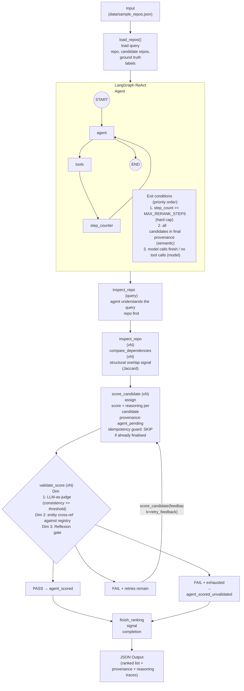

# Preliminary Investigations on Agentic Reranking

This section touches on the experimentation done to explore the use of agentic AI as a **semantic reranker** for cross-language repository similarity. The exploration is motivated by **RQ3**: *Can an agentic workflow reasoning over inspect4all’s structured JSON metadata match or surpass embedding-based cosine similarity for similarity ranking?*

The experiment is on the notebook:

- [`reranker.ipynb`](./reranker.ipynb) -- LangGraph ReAct agent that reasons over structured metadata to rank candidate repositories by similarity to a query repository

## Setup

Ensure `uv` (https://docs.astral.sh/uv/) is installed as the notebooks are in a Python virtual environment managed by `uv`.

```sh
# run sync to sync the environment with all dependencies according to the lock file
uv sync
```

## Running the Notebook

Launch Jupyter and open `reranker.ipynb`:

```sh
uv run jupyter notebook reranker.ipynb
```

Then run all cells in order via **Cell > Run All**.

For `reranker.ipynb`, create a `.env` file with:

```sh
OPENAI_API_KEY=sk-...
```

---

## Agentic Pipeline Architecture

The pipeline follows the **ReAct pattern** (Yao et al., 2022) -- a Thought -> Action -> Observation loop implemented via LangGraph. Three quality mechanisms are layered on top:

- **CRAG-style confidence gate** - LLM-as-judge validates whether the numeric score is consistent with the stated reasoning before finalising
- **Reflexion-style retry** - verbal feedback from `validate_score` is passed back to `score_candidate` when consistency is low
- **Truthfulness cross-reference** - package-like entity names in the reasoning are cross-referenced against `_repo_registry`; unverified names penalise confidence

### Tools Registered

| Tool | Purpose | Theory |
| ---- | ------- | ------ |
| `inspect_repo` | Full metadata lookup for any repository (query or candidate) -- software_type, key_functions, dependencies | ReAct |
| `compare_dependencies` | Structural overlap signal between query and a candidate (shared count, Jaccard similarity) | ReAct |
| `score_candidate` | Record similarity score (0.0-1.0) + explicit reasoning; accepts Reflexion feedback on retry | Reflexion |
| `validate_score` | LLM-as-judge consistency check + truthfulness cross-reference; Reflexion retry gate | CRAG, Reflexion |
| `finish_ranking` | Signal reranking complete (guards against premature exit) | -- |

### Processing Flow



---

## Design Decisions

### Registry Pattern

Tools never accept a full repository `dict` as an argument. All repository data lives in server-side registries keyed by repository ID:

```
_repo_registry  : dict[str, dict]  -- ground-truth metadata from sample_repos.json (read-only)
_score_registry : dict[str, dict]  -- scores + provenance written by score_candidate/validate_score
_retry_registry : dict[str, int]   -- Reflexion retry counter per candidate
_query_id       : str              -- module-level context for compare_dependencies
_candidate_ids  : list[str]        -- candidate IDs for semantic exit check
```

This eliminates a class of LLM hallucination where the model reconstructs partial or incorrect dicts when calling tools.

### Jaccard Dependency Overlap

`compare_dependencies` computes `|shared| / |union|` across the query and candidate dependency lists. High Jaccard overlap is a strong structural signal -- libraries that share `bouncy-castle`, `junit`, and `jackson` are likely in the same functional domain. This gives the agent grounded evidence beyond the LLM's parametric knowledge.

### Provenance Chain

Every candidate carries a `provenance` field in `_score_registry` tracking its state:

```
agent_pending -> agent_scored           (validated pass)
             -> agent_scored_unvalidated (retries exhausted)
```

This enables multi-condition ablation in RQ3 evaluation -- scores can be compared at each stage.

### CRAG-Style Confidence Gate

`validate_score` calls an LLM judge to check whether the numeric score is consistent with the stated reasoning. The judge returns a `consistency` float (0.0-1.0). If consistency falls below `VALIDATION_CONFIDENCE_THRESHOLD`, validation fails and a Reflexion retry is triggered.

### Reflexion Retry Gate

When validation fails and retries remain, `validate_score` returns `retry_recommended=True` with a `retry_feedback` string summarising the inconsistency. The agent calls `score_candidate(feedback=retry_feedback)` to revise the score/reasoning. `_retry_registry` tracks attempts per candidate; once `MAX_RETRY_RERANK` is reached, the score is finalised as `agent_scored_unvalidated`.

### Truthfulness Cross-Reference

`validate_score` extracts package-like tokens from the reasoning text (e.g. `com.auth0.jwt`, `nimbus-jose-jwt`) and cross-references them against `_repo_registry`. Each unverified entity reduces confidence by 0.1 (up to a 0.3 penalty), penalising hallucinated library or package names.

### Idempotency Guard

Both `score_candidate` and `validate_score` check current provenance before executing. If a candidate has already reached a final state (`agent_scored` or `agent_scored_unvalidated`), the tool returns a `SKIP` message immediately.

### Model-Agnostic Exit Condition

`should_continue` inspects `_score_registry` directly to determine if all candidates are in final provenance. This decouples pipeline termination from the model's ability to call `finish_ranking`, ensuring the pipeline exits cleanly even if the model omits the finish call.

### Mixed-Signal Reasoning

The agent reasons over a mixture of signals:

| Signal | In embedding? | Agent contribution |
| ------ | ------------- | ------------------ |
| README text | Yes (README embedding) | Re-reasons over content |
| Code + docstrings | Yes (code + doc embedding) | Re-reasons over content |
| `software_type` | No | Explicit categorical judgment (library vs framework) |
| `dependencies` | No | Jaccard overlap + semantic meaning of shared deps |
| `language` | Partial | Cross-language port identification (same spec in different language) |
| Cross-signal synthesis | No | The core value -- combines all signals into a score with rationale |

Language difference is not a disqualifier -- the agent identifies cross-language ports
(e.g., PyJWT and java-jwt both implement RFC 7519; the language difference signals
a functional port, not a domain mismatch).

### Agent Reranker vs Embedding Baseline

The agentic reranker is the second stage of a hybrid two-stage pipeline:

```
Stage 1 (Embedding retrieval):  cosine similarity -> top-k candidates  (fast, recall-focused)
Stage 2 (Agentic reranking):    LLM reasons over top-k metadata       (slow, precision-focused)
```

Embeddings collapse all signals into a fixed-length vector, losing the ability to reason
about *why* two repositories are similar. The agent's unique contribution is interpretable
cross-signal reasoning: it can distinguish a cross-language port (high similarity) from a
same-language framework that happens to include JWT support (medium similarity), and produce
an auditable rationale for each judgment.

---

## Configuration

The notebook exposes pipeline parameters in a dedicated config cell:

| Parameter | Default | Purpose |
| --------- | ------- | ------- |
| `LLM_MODEL` | `gpt-5.4` | OpenAI model backbone |
| `REASONING_EFFORT` | `low` | Reasoning effort setting for the model |
| `MAX_RERANK_STEPS` | `20` | Hard step cap per agent invocation |
| `MAX_RETRY_RERANK` | `2` | Max Reflexion retries per candidate before finalising as unvalidated |
| `VALIDATION_CONFIDENCE_THRESHOLD` | `0.7` | Minimum confidence for `validate_score` to pass (CRAG-style gate) |

---

## Data

`data/sample_repos.json` contains one query repository (`auth0/java-jwt`) and five candidates with manually curated ground truth similarity labels:

| Candidate | Language | Type | GT Label |
| --------- | -------- | ---- | -------- |
| `jpadilla/pyjwt` | Python | library | HIGH |
| `mpdavis/python-jose` | Python | library | HIGH |
| `connect2id/nimbus-jose-jwt` | Java | library | HIGH |
| `spring-projects/spring-security` | Java | framework | MEDIUM |
| `psf/requests` | Python | library | LOW |

---

## Observations from Experiment

1. **Reasoning quality** -- The agent produces explicit rationale per candidate covering purpose overlap, dependency overlap, language/type match, and disqualifying differences.

2. **Cross-language ranking** -- The agent can directly compare Python and Java repositories from metadata alone. No embeddings required. Functional similarity (both expose JWT sign/verify with matching algorithm dependencies) is identified correctly.

3. **Structural signals** -- `compare_dependencies` (Jaccard) provides a grounded structural overlap signal that reduces reliance on the LLM's parametric knowledge alone.

4. **Interpretability** -- Each score comes with a reasoning trace, making the ranking fully auditable -- a property that embedding-based cosine similarity lacks.
