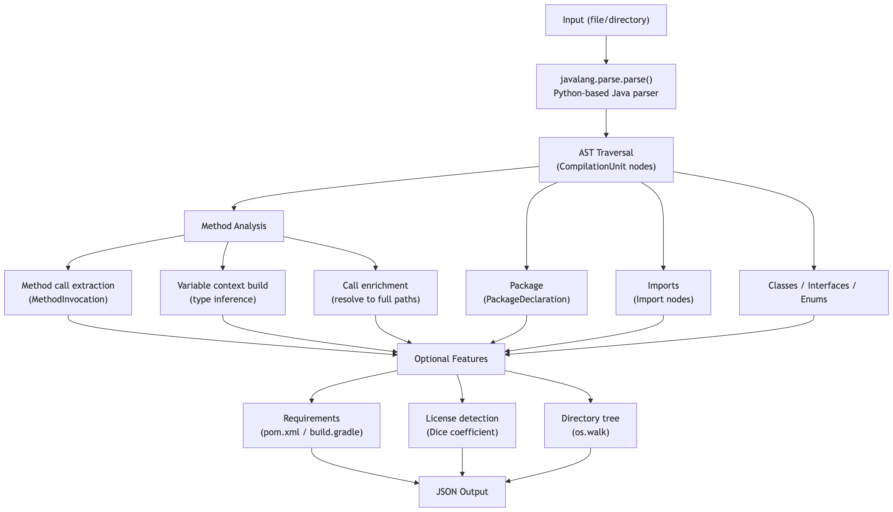

# Preliminary Investigations on inspect4j

Initial exploration is carried out using jupyter notebook: [inspect4j.ipynb](./inspect4j.ipynb)

## Setup

Ensure `uv` (https://docs.astral.sh/uv/) is installed as the notebook is in a Python virtual environment managed by `uv`.

```sh
# run sync to sync the environment with all dependencies according to the lock file
uv sync
```

## Running the Notebook

Launch Jupyter and open `inspect4j.ipynb`:

```sh
uv run jupyter notebook inspect4j.ipynb
```

Then run all cells in order via **Cell > Run All**. The notebook will:
1. Clone the Spring Boot sample repository (requires internet access and `git`)
2. Run `inspect4j` on it and display extracted metadata
3. Create a minimal Java 17 record class locally and run `inspect4j` on it to demonstrate the `javalang` Java 9+ limitation

## Codebase Deepdive

The codebase is a Python tool for static analysis of Java repositories. It uses the **javalang** library for AST parsing - a pure Python parser that doesn't require Java runtime. The architecture is similar to inspect4py but adapted for Java's static type system.

### Technology Stack by Feature

| Feature                | Technology                         | Thoughts / Remarks                                              |
| ---------------------- | ---------------------------------- | --------------------------------------------------------------- |
| Code Parsing           | `javalang` library                 | Pure Python Java parser, no JDK required, supports up to Java 8 |
| JavaDoc Extraction     | Custom regex-based parser          | Manual extraction from source comments, no external dependency  |
| Control Flow Graph     | Not implemented                    | No CFG module found in code |
| Data Flow Graph        | Not implemented                    | No DFG module found despite `tree-sitter` library found in dependencies |
| Requirements Detection | Custom Maven/Gradle parsers        | Parses pom.xml and build.gradle for dependencies                |
| License Detection      | Dice coefficient (text similarity) | Same approach as inspect4py, compares against templates         |
| Directory Tree         | `os.walk()` + `pathlib`            | Standard Python filesystem traversal                            |
| CLI Interface          | `click` library                    | Declarative argument parsing                                    |
| HTML Output            | `json2html` library                | JSON to HTML table conversion                                   |
| Git Metadata           | `GitPython` library                | Repository info extraction                                      |
| Encoding Detection     | `chardet` library                  | Multi-strategy encoding detection for diverse codebases         |

### Code Architecture Overview

```
inspect4j/
├── main.py              # CLI entry point (~92 lines)
│   └── inspect4j_main() # Click-based command parsing
│
├── java_inspector.py    # Core analysis engine (~2820 lines)
│   └── JavaInspection   # Main analysis class
│       ├── parse_file()           # javalang.parse.parse()
│       ├── inspect_package()      # Package declaration
│       ├── inspect_imports()      # Import statements
│       ├── inspect_classes()      # Classes, interfaces, enums
│       ├── inspect_methods()      # Method extraction
│       ├── inspect_fields()       # Field declarations
│       ├── extract_javadoc()      # JavaDoc comments
│       ├── _extract_method_calls()    # Method call extraction
│       ├── _enrich_all_method_calls() # Call resolution with types
│       └── create_file_json()     # Output generation
│
├── java_utils.py        # Utility functions (~1884 lines)
│   ├── read_file_with_encoding_detection()  # Safe file I/O
│   ├── get_type_name()              # AST type extraction
│   ├── expression_to_str()          # Expression stringification
│   ├── resolve_inheritance_method_call()  # Inheritance resolution
│   ├── extract_maven_dependencies()  # pom.xml parsing
│   ├── extract_gradle_dependencies() # build.gradle parsing
│   ├── detect_license()             # License matching
│   └── extract_directory_tree()     # Directory structure
│
├── structure_tree.py    # Directory tree utilities (~193 lines)
│   └── DisplayablePath  # Tree visualization class
│
└── licenses/            # License detection templates
    ├── mit.txt
    ├── apache-2.0.txt
    ├── gpl-3.0.txt
    ├── lgpl-3.0.txt
    └── bsd-3-clause.txt
```

---

### Key Processing Flow




---

### Key Differences from inspect4py

| Aspect            | inspect4py                         | inspect4j                               |
| ----------------- | ---------------------------------- | --------------------------------------- |
| Parser            | Python `ast` module (built-in)     | `javalang` library (external)           |
| Type System       | Dynamic typing                     | Static typing with full type extraction |
| CFG/DFG           | Implemented (staticfg/tree-sitter) | Not implemented                         |
| Requirements      | `pigar` (subprocess)               | Custom Maven/Gradle parsers             |
| Doc Extraction    | `docstring_parser` library         | Custom regex JavaDoc parser             |
| Encoding Handling | Basic                              | Multi-strategy with chardet             |
| Method Resolution | N/A (dynamic)                      | Inheritance-aware call resolution       |
| Codebase Size     | ~2000+ lines                       | ~4989 lines                             |

---

### Javalang AST Node Types Used

| Node Type                  | Purpose                     |
| -------------------------- | --------------------------- |
| `CompilationUnit`          | Root of parsed file         |
| `ClassDeclaration`         | Class definitions           |
| `InterfaceDeclaration`     | Interface definitions       |
| `EnumDeclaration`          | Enum types                  |
| `MethodDeclaration`        | Regular methods             |
| `ConstructorDeclaration`   | Constructor methods         |
| `FieldDeclaration`         | Class/instance fields       |
| `LocalVariableDeclaration` | Local variables in methods  |
| `MethodInvocation`         | Method calls                |
| `ClassCreator`             | Constructor calls (new X()) |
| `Import`                   | Import statements           |
| `PackageDeclaration`       | Package statement           |
