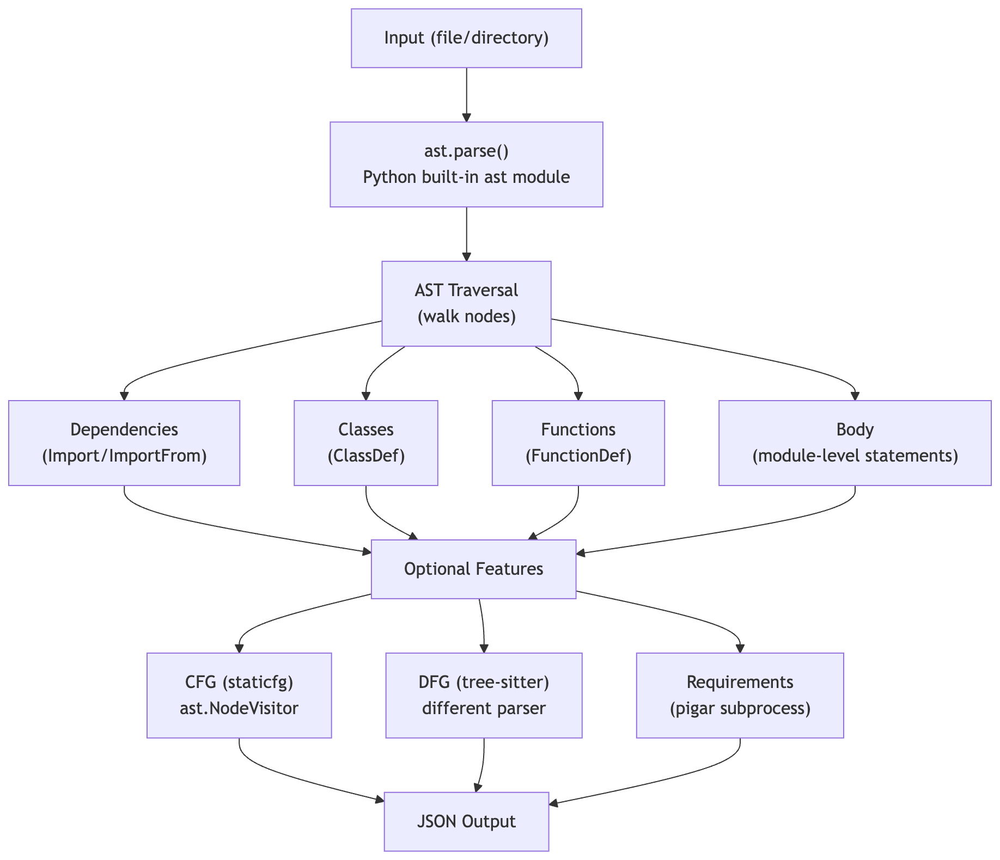

# Preliminary Investigations on inspect4py (and RepoSim4Py)

Exploration is carried out using jupyter notebook: [inspect4py.ipynb](./inspect4py.ipynb)

## Setup

Ensure `uv` (https://docs.astral.sh/uv/) is installed as the notebook is in a Python virtual environment managed by `uv`.

```sh
# run sync to sync the environment with all dependencies according to the lock file
uv sync
```

## Running the Notebook

Launch Jupyter and open `inspect4py.ipynb`:

```sh
uv run jupyter notebook inspect4py.ipynb
```

Then run all cells in order via **Cell > Run All**.

## Codebase Deepdive

It seems the vast majority of the codebase relies on Python's built-in `ast` module. While `tree-sitter` is included as a dependency, it is used only for the DFG (data flow) feature.

### Technology Stack by Feature

| Feature                 | Technology                         | Thoughts / Remarks                                            |
| ----------------------- | ---------------------------------- | ------------------------------------------------------------- |
| Code Parsing            | Python `ast` module                | Native, zero-dependency? simplicity? reliable for Python code |
| Docstring Extraction    | `docstring_parser` library         | Supports Google, NumPy, Sphinx formats out of the box         |
| Control Flow Graph      | Custom `staticfg` (AST visitor)    | Visual CFG generation with Graphviz                           |
| Data Flow Graph         | `tree-sitter`                      | Token-level parsing needed for DFG relationships              |
| Requirements Detection  | `pigar` (subprocess)               | Analyzes imports and maps to PyPI packages                    |
| License Detection       | Dice coefficient (text similarity) | Compares against known license templates                      |
| Software Classification | Heuristic rules                    | Multi-signal analysis for type detection                      |
| Directory Tree          | `os.walk()` + `pathlib`            | Standard Python filesystem traversal                          |
| CLI Interface           | `click` library                    | Declarative argument parsing                                  |
| HTML Output             | `json2html` library                | JSON to HTML table conversion                                 |
| Git Metadata            | `GitPython` library                | Repository info extraction                                    |

### Code Architecture Overview

```
inspect4py/
├── cli.py              # Main entry point, CodeInspection class
│   └── CodeInspection  # Core analysis engine (~1200 lines)
│       ├── parser_file()        # ast.parse()
│       ├── inspect_file()       # File-level metadata
│       ├── inspect_dependencies()  # Import extraction
│       ├── inspect_classes_funcs() # Class/function extraction
│       ├── inspect_body()       # Module-level code
│       ├── inspect_controlflow() # CFG generation
│       └── _f_definitions()     # Function details extraction
│
├── utils.py            # Utility functions
│   ├── extract_requirements()     # pigar integration
│   ├── extract_software_invocation()  # Type classification
│   ├── DFG_python()              # Data flow graph (tree-sitter)
│   ├── detect_license()          # License matching
│   └── extract_directory_tree()  # Directory structure
│
├── staticfg/           # Control flow graph module
│   ├── builder.py      # CFGBuilder (ast.NodeVisitor)
│   └── model.py        # Block, Link data structures
│
├── parse_setup_files.py  # setup.py/setup.cfg parsing
├── structure_tree.py     # Directory tree utilities
└── resources/            # tree-sitter language binaries
```

---

### Key Processing Flow




## RepoSim4Py

RepoSim4Py is a tool for computing similarity between two GitHub repositories at multiple levels of abstraction. While inspect4py focuses on extraction, RepoSim4Py provides the similarity reasoning layer that completes the architectural pipeline.

### Technology Stack & Implementation

The experiment uses the pretrained **`Henry65/RepoSim4Py`** model (based on **UniXcoder**) from Hugging Face. The implementation leverages the `transformers` library to generate vector embeddings for two repositories, which are then compared using cosine similarity across four distinct levels. These individual levels are then aggregated into a final repository level similarity score.

| Embedding Level | Description | Purpose |
| --- | --- | --- |
| `Code` | Average across all source code files | Structural and logic similarity |
| `Doc` | Extracted docstrings and comments | Functional and semantic similarity |
| `Readme` | Project README content | High level purpose similarity |
| `Requirement` | Dependency lists (pip, maven, etc.) | Technology stack similarity |

### Key Findings

The experiment validated that comparing repositories across these four levels provides a more detailed picture of similarity than a single monolithic vector. The final **`Repository`** similarity (repo sim) is a weighted aggregation of these components. High similarity in the `Readme` level often indicates shared intent, while `Requirement` similarity can identify projects with identical technology stacks. This multi level approach is foundational for repository similarity work in this dissertation.

In addition, the experiment reproduces the running of both the inspect4py and the RepoSim4Py model for repository similarity ranking. This validates the extraction to similarity pipeline.